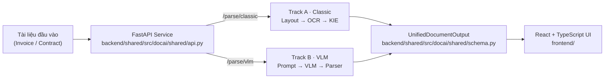

<p align="center">
  
</p>

<p align="center">
  
  
  
  
  
  
</p>

<p align="center"><strong>Nền tảng thử nghiệm trích xuất thông tin tài liệu (Invoice &amp; Contract) theo hai kiến trúc độc lập — Classic Multi-Stage và VLM-Native — dùng chung một API &amp; Output Contract.</strong></p>

<p align="center">
  <a href="#tổng-quan-dự-án">Tổng quan</a> ·
  <a href="#kiến-trúc--hai-track-xử-lý">Hai track xử lý</a> ·
  <a href="#cấu-trúc-repository">Cấu trúc repo</a> ·
  <a href="#chạy-local-quick-start">Chạy local</a> ·
  <a href="#hợp-đồng-api">API contract</a> ·
  <a href="#kiểm-thử--tài-liệu">Kiểm thử &amp; Tài liệu</a>
</p>

---

## Tổng quan dự án

**DocAI** là dự án thử nghiệm và so sánh hai hướng tiếp cận AI để trích xuất dữ liệu có cấu trúc từ **Invoice** (hóa đơn) và **Contract** (hợp đồng). Hệ thống dùng backend **FastAPI** làm lớp điều phối thống nhất và giao diện **React + TypeScript + Vite** để thao tác trên cùng một schema đầu ra [`UnifiedDocumentOutput`](backend/shared/src/docai/shared/schema.py).

- **Track A — Classic Multi-Stage:** `tài liệu → layout → OCR → KIE → UnifiedDocumentOutput`
- **Track B — VLM-Native:** `tài liệu + prompt → VLM → parse/validate → UnifiedDocumentOutput`

> [!NOTE]
> **Trạng thái hiện tại:** Cả **Track A** và **Track B** đều đang ở mức **scaffold**. Chưa chọn model/checkpoint chính thức và hai route parse (`/parse/classic`, `/parse/vlm`) hiện trả về `501 Not Implemented`. Prompt hoặc schema hợp lệ không được xem là bằng chứng inference đã chạy.

---

## Kiến trúc & Hai track xử lý



| Tiêu chí | Track A — Classic | Track B — VLM |
| --- | --- | --- |
| **Chiến lược** | Đa tầng tách biệt: Layout Detection → OCR → Key Information Extraction | Trực tiếp từ ảnh/PDF tài liệu + prompt có cấu trúc |
| **Module Python** | [`backend/track-a/`](backend/track-a/README.md) | [`backend/track-b/`](backend/track-b/README.md) |
| **CLI kiểm tra** | [`backend/track-a/scripts/run.py`](backend/track-a/scripts/run.py) | [`backend/track-b/scripts/run.py`](backend/track-b/scripts/run.py) |
| **API Route** | `POST /parse/classic` | `POST /parse/vlm` |
| **Đầu ra chuẩn** | `UnifiedDocumentOutput` | `UnifiedDocumentOutput` |
| **Tình trạng** | Scaffold (`501`) | Scaffold (`501`) |

Chỉ bổ sung phần hỗ trợ mới khi đã chọn model và có đầu việc cụ thể.

---

## Cấu trúc repository

```text
backend/
├── shared/src/docai/shared/  FastAPI, config và schema dùng chung
├── track-a/                  Thành viên A: src/ và scripts/ riêng
└── track-b/                  Thành viên B: src/ và scripts/ riêng
tests/
├── unit/                  Unit test cho schema và config
└── integration/           Integration test cho API routes
frontend/                  Giao diện React 18 + TypeScript + Vite
docs/                      Kiến trúc, hướng dẫn, khái niệm và task owner
docker-compose.yml         Cấu hình chạy API bằng Docker Compose
pyproject.toml             Khai báo package docai và dependencies
AGENTS.md                  Quy tắc làm việc cho AI agent trong repository
```

---

## Chạy local

### 1. Cài đặt môi trường & chạy Backend API

Yêu cầu **Python 3.10+**. Từ thư mục gốc của repository:

```powershell
python -m venv .venv
.venv\Scripts\Activate.ps1
python -m pip install -r requirements.txt
uvicorn docai.shared.api:app --reload --host 127.0.0.1 --port 8000
```

Sau khi khởi động, kiểm tra service tại `http://127.0.0.1:8000/health` hoặc tài liệu Swagger tại `http://127.0.0.1:8000/docs`.

### 2. Chạy Frontend (trong terminal khác)

Yêu cầu **Node.js 18+**:

```powershell
cd frontend
npm install
npm run dev
```

### 3. Chạy bằng Docker Compose (tùy chọn)

```powershell
docker compose up --build
```

### 4. Chạy CLI kiểm tra scaffold

Các lệnh CLI hiện chỉ kiểm tra tính hợp lệ của tham số đầu vào và in thông tin scaffold (chưa chạy inference model):

```powershell
python backend/track-a/scripts/run.py --image path/to/document.jpg
python backend/track-b/scripts/run.py --image path/to/document.jpg --type invoice
```

---

## API

| Endpoint | Method | Chức năng | Trạng thái hiện tại |
| --- | --- | --- | --- |
| `/health` | `GET` | Kiểm tra trạng thái hoạt động và phiên bản service | `200 OK` |
| `/parse/classic` | `POST` | Trích xuất tài liệu theo pipeline Track A (`file`, `document_type`) | `501 Not Implemented` |
| `/parse/vlm` | `POST` | Trích xuất tài liệu theo pipeline Track B (`file`, `document_type`) | `501 Not Implemented` |

> [!IMPORTANT]
> **Đồng bộ Schema:** Mọi thay đổi đối với [`backend/shared/src/docai/shared/schema.py`](backend/shared/src/docai/shared/schema.py) bắt buộc phải được cập nhật tương ứng trong [`frontend/src/types/document.ts`](frontend/src/types/document.ts) để giữ đồng bộ hợp đồng giữa backend và frontend.

---

## Kiểm thử & Tài liệu

Chạy test Python hiện có:

```powershell
python -m unittest discover -s tests -p "test_*.py" -v
```

### Tài liệu tham khảo trong repo

- [Hướng dẫn chạy chi tiết](docs/how-to-run.md)
- [Kiến trúc hệ thống](docs/architecture.md)
- [Khái niệm DocAI & Processing Tracks](docs/processing-tracks.md)
- [Kế hoạch Track A](docs/tasks/track-a-classic.md)
- [Kế hoạch Track B, ownership tổng thể và các workstream dùng chung](docs/tasks/track-b-vlm.md)
- [Quy tắc repository (`AGENTS.md`)](AGENTS.md)

---

## Giấy phép

Phát hành theo giấy phép **Apache-2.0**.
